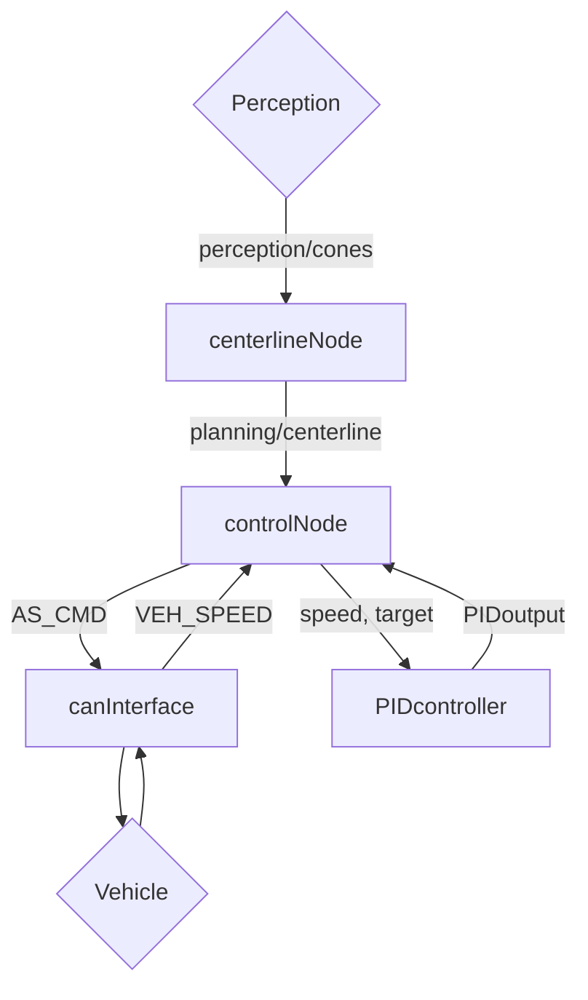

# recruiting-sw-control Report
## 1. General Approach
My approach was to divide the bigger problem into **smaller components** in ROS2. This allowed me to learn, develop and debug diffrent parts od the project one after the other. Starting from learning how to setup the VS Code environment, to building and testing fully working modules.

## 2. System architecture

I used 4 main nodes with the following architecture:

Every node is responsible for a specific task. 

* **`centerlineNode`** listens to perception updates via _`/perception/cones`_, computes the centerline and publishes it to _`/planning/centerline`_.

* **`controlNode`** is the main Node, listens for updates coming from _`/planning/centerline`_ to get the path. Using CAN reads `VEH_SPEED` and sends periodically `AS_CMD`, and communicates with `PIDcontroller` node to get the PID output.

* **`canInterface`** implements the functions used by `controlNode` to communicate with the vehicle via CAN.

* **`PIDcontroller`** implements on the other hand the **PID**, used to control `throttle` and `brake`.

## 3. Centerline Generation

The Centerline is calculated by first dividing the cones arriving from _`/perception/cones`_ left and right using the `.color` attribute. To pair the cones efficiently the code finds the pair between left and right with a Horizontal Offset less that's less than `config.CONES_MAX_X_OFFSET`, _3m_ by default.

> If any cone is missing the loop will skip the pair and doesn't push it back in the path vector.

To detect the stopping box, it pairs the `ORANGE` cones by first sorting them from nearest to farthest to assure the correct order, then if the count is even it pairs the first 2 and the last 2 together.

> If 2 cones in a pair have a X offset bigger than `config.CONES_MAX_X_OFFSET` it skips the pair and doesn't push it back in the path vector.

## 4. Speed Control and Stopping Logic

The cotroller lays in the `mainLoop()` function, inside the `controlNode` Node, that runs every `config.CLOCK_MS` ms, _10ms_ by default. It reads the speed using `canInterface` module and makes sure it's a reasonable value. And sends the `AS_CMD` command every loop to the vehicle.

To get the path published in `/planning/centerline` it has a subscriber that saves the path in a private variable called `lastestPath`, it also stores its age, so if a path published is invalid, it keeps the older one. If a path ages over `config.MAX_PATH_AGE` the run stops.

> A path is considered invalid if:
> * It's empty
> * After receiving both stopping points once, it doesn't contain both stopping points.

If neither of the stopping points are detected, `target` is set to `config.TARGET_SPEED`, _35m/s_ by default. If the stopping point is in sight, the `target` is set to the exact speed to teoreticly keep to come in a full stop given a `distanceToStop` distance.

Both `throttle` and `brake` are controlled by a PID Controller inside the `PIDcontroller` module tuned with `Kp`, `Ki` and `Kd` inside configs. To smooth the output `rateLimiter()` is used, setting the max step every loop to `config.MAX_OUTPUT_STEP`, _0.2_ by default.

## 5. CAN Interface Configuration

To communicate with the vehicle the `controlNode` Node uses the `canInterface` module, that first builds the `can` object named _vcan0_, assigns it a socket and checks if the creation is successfull.

`canInterface` also containes `sendFrame()` and `receiveFrame()` that use the generated code by **CanTools** to encode and decode the values.

## 6. Testing and Results

To test and tune the configs, I used both **Rosbags** and **Plotjuggler**, I also created a 2d RViz display to debug the live values of `speed`, `target`, `throttle` and `brake`, all published on diffrent ROS topics.

The Rosbag in the `/record/control_run` folder took around _5.8s_. The directory contains both the `.db3` file and 2 graphs. First one has `speed` and `target`, second one `throttle` and `brake`.

<table>
  <tr>
    <td></td>
    <td></td>
  </tr>
</table>

## 8. AI Usage
I personally use GPT to learn new coding topics, during this project I used it mainly to understand the diffrent mechanics involving both the setup of the enviroment and the project itself. No line of code was copy-pasted from GPT, even during debugging, it's important for me what and where was the problem in the code.

Here's a chart to better show AI Usage:

| Area | GPT role | Personal Contribution |
| ------------- |:-------------:|:-------------:|
| Development environment | Explained **WSL**, **Docker**, **VS Code** and **ROS 2** setup | Configured the environment, **VS Code**, **GitHub Repository** and got the simulation running |
| C++ and ROS2 | Explained classes, nodes, topics and pointers | Implemented all the nodes and used what I learnt to create multiple classes and functions to make the code cleaner |
| PID Controller | Helped on config tuning | Fully implemented the `PIDcontroller` module. |
| CAN Interface | Explained **SocketCAN**, **CAN Frames** and to use **CAN Tools** | Integrated the `canInterface` module, handled various failure cases. |
| Debugging | Helped intepret errors | Looked for possible fixes, applied changes and verified the results |
| Testing and Documentation | Suggested testing approaches and helped organise the report and README | Ran simulations, recorded rosbags and analyzed plots |