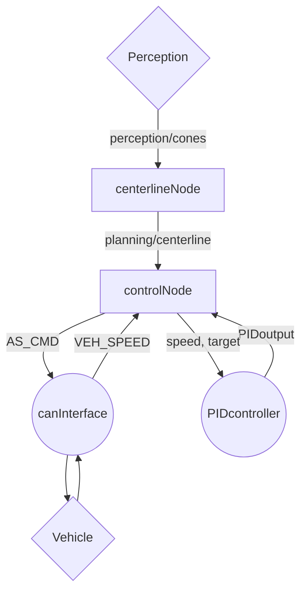
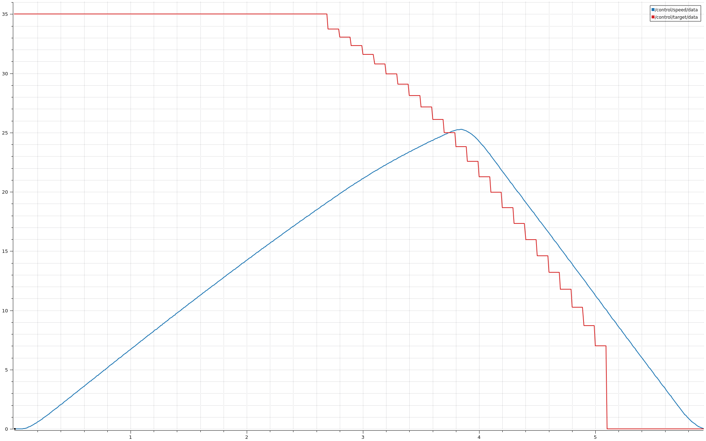
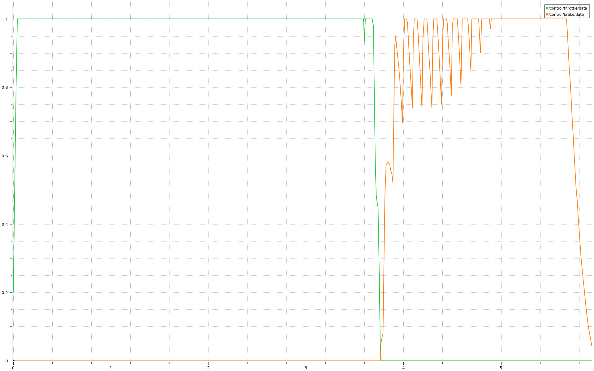

# recruiting-sw-control Report
## 1. General Approach
My approach was to divide the bigger problem into **smaller components** in ROS2. This allowed me to learn, develop and debug different parts of the project one after the other. I started from learning how to set up the VS Code environment, the moved to building and testing fully working modules.

## 2. System architecture

I used 2 main nodes and 2 modules with the following architecture:

Every component is responsible for a specific task. 

* **`centerlineNode`** listens to perception updates via _`/perception/cones`_, computes the centerline and publishes it to _`/planning/centerline`_.

* **`controlNode`** is the main node, listens for updates coming from _`/planning/centerline`_ to get the path. Using CAN reads `VEH_SPEED` and sends periodically `AS_CMD`, and communicates with `PIDcontroller` module to get the PID output.

* **`canInterface`** implements the functions used by `controlNode` to communicate with the vehicle via CAN.

* **`PIDcontroller`** implements the **PID**, used to control `throttle` and `brake`.

## 3. Centerline Generation

The centerline is calculated by first dividing the cones received from _`/perception/cones`_ left and right groups using the `color` attribute. To pair the cones efficiently the code finds the pair between left and right with a horizontal offset smaller than `config.CONES_MAX_X_OFFSET`, _3m_ by default.

> If any cone is missing the loop will skip the pair.

To detect the stopping points, one for every pair, it pairs the `ORANGE_BIG` cones by first sorting them from nearest to farthest to assure the correct order, then if the count is even it pairs the first two cones and the last two cones.

> If 2 cones in a pair have a x-offset bigger than `config.CONES_MAX_X_OFFSET` it skips the pair.

## 4. Speed Control and Stopping Logic

The controller is implemented in the `mainLoop()` function, inside the `controlNode` node, that runs every `config.CLOCK_MS` ms, _10ms_ by default. It reads the speed using `canInterface` module and checks the value is reasonable. It also sends an `AS_CMD` command to the vehicle every loop iteration.

To receive the path published in `/planning/centerline` it has a subscriber that saves the path in a private variable called `latestPath`, it also tracks its age and keeps the previous path if a new path is considered invalid. If a path becomes older than `config.MAX_PATH_AGE` the controller stops.

> A path is considered invalid if:
> * It's empty
> * After both stopping points have been detected, a path that doesn't contain both stopping points is cnsidered invalid

If neither of the stopping points is detected, `target` speed is set to `config.TARGET_SPEED`, _35m/s_ by default. If a stopping point is detected, the `target` speed calculated using the theoretical speed required to stop over the remaining distance, based on `config.MAX_DECEL`.

Both `throttle` and `brake` are controlled by a PID controller implemented in the `PIDcontroller` module. Its configs (`Kp`, `Ki` and `Kd`) are configured in the YAML file. To smooth the output, `rateLimiter()` is used, setting the maximum change per loop iteration to `config.MAX_OUTPUT_STEP`, _0.2_ by default.

## 5. CAN Interface Configuration

To communicate with the vehicle the `controlNode` node uses the `canInterface` module to communicate with the vehicle. It creates a `CanInterface` object confgured to use the _vcan0_ interface, opens a socket and checks for any failures.

`canInterface` provides `sendFrame()` and `receiveFrame()`, which use generated code by **CanTools** to encode and decode CAN messages.

## 6. Testing and Results

To test and tune the configs, I used both **rosbags** and **PlotJuggler**, I also created a 2D RViz display to debug the live values of `speed`, `target`, `throttle` and `brake`, all published on different ROS topics.

The rosbag situated in the `/record/control_run` folder stores a run that took around _5.8s_. The directory contains both the `.db3` file and 2 graphs. First one has `speed` and `target`, second one `throttle` and `brake`.

<table>
  <tr>
    <td></td>
    <td></td>
  </tr>
</table>

## 7. AI Usage
I use GPT to learn new coding topics. During this project, I used mainly it to understand the enviroment setup and the individual concepts and mechanics involved. No line of code was copy-pasted from GPT. Even during debugging, it was important for me to undestand what caused each problem and where it occured.

The following table summerises the AI Usage in this project:

| Area | GPT role | Personal Contribution |
| ------------- |:-------------:|:-------------:|
| Development environment | Explained **WSL**, **Docker**, **VS Code** and **ROS 2** setup | Configured the environment, **VS Code**, **GitHub Repository** and got the simulation running |
| C++ and ROS 2 | Explained classes, nodes, topics and pointers | Implemented all the nodes and used what I learnt to create multiple classes and functions to make the code cleaner |
| PID Controller | Helped on config tuning | Fully implemented the `PIDcontroller` module. |
| CAN Interface | Explained **SocketCAN**, **CAN Frames** and to use **CAN Tools** | Integrated the `canInterface` module, handled various failure cases. |
| Debugging | Helped intepret errors | Looked for possible fixes, applied changes and verified the results |
| Testing and Documentation | Suggested testing approaches and helped organise the report and README | Ran simulations, recorded rosbags and analyzed plots |